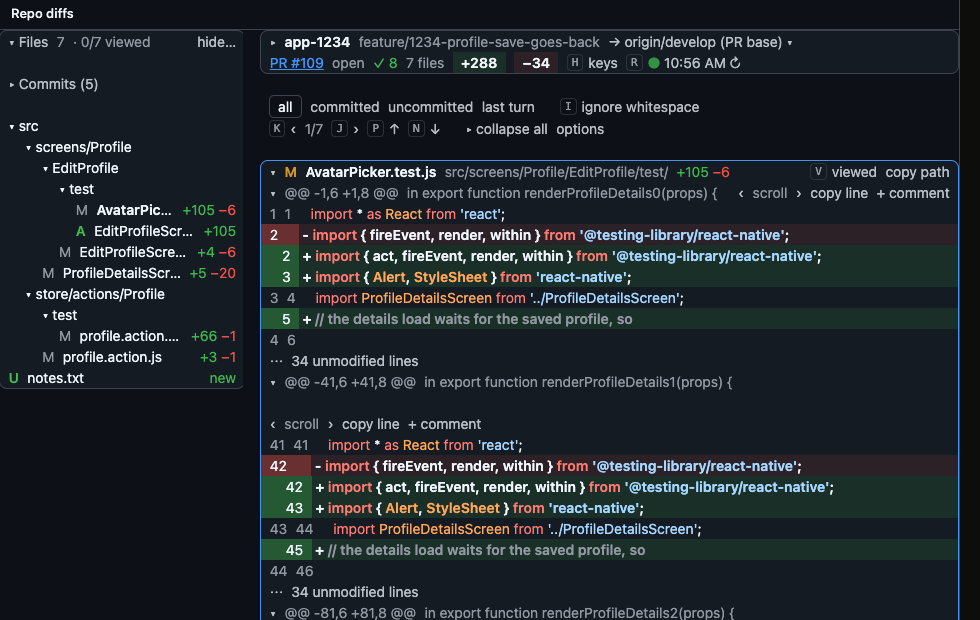

# Claude Code mods: cache-status, usage-hp, ticket-phase, agents-panel and repo-diffs

Five small mods for Claude Code. Four add a row to the band just above the
prompt box, in the desktop app's Code tab and in the terminal; agents-panel
also opens an `Agents` pane. The fifth, [repo-diffs](repo-diffs/README.md),
adds no row: it opens a **Repo diffs** pane with the branch diff of every repo
the session edits outside its own folder.

In the desktop app (every picture here is rendered from the mods' own drawing
code by `docs/render.sh`):

<picture><source media="(prefers-color-scheme: dark)" srcset="agents-panel/docs/band-dark.svg"></picture>

<picture><source media="(prefers-color-scheme: dark)" srcset="ticket-phase/docs/row-dark.svg"></picture>

<picture><source media="(prefers-color-scheme: dark)" srcset="usage-hp/docs/subscription-dark.svg"></picture>

In the terminal the same rows are text:

    ● 3 running · 270k · 2:14 ×3
    ● CACHE WARM · 59m left of 1h · last hit 100%
    ♥ 5H  ████████████░░░░░░░░  62% left · resets in 2h 14m · lasts past reset
    ♡ 7D  ███████░░░░░░░░░░░░░  34% left · resets in 4d · empty in ~2d 9h at this pace
          $0.30 this session
    #12345 full ◆◆◆◆◈◇◇◇ 5 Implement 23m/41m · ~2h10m left · 184k · R6×2

They only read figures Claude Code already has and draw them. They add no
tools, and nothing in them makes a model call or adds to the prompt on its
own, so they do not add to your usage. Two buttons act only when you press
them: cache-status's cold-send guard can compact the conversation (**Compact
now, then send**), and repo-diffs' **Send to prompt** fills the prompt box with
your review comments. The Clawds are the Claude Code mascot: agents-panel gives each
agent type its own costume, and ticket-phase gives each phase its own prop.

## What each row tells you

### cache-status

Claude Code caches your conversation so each message re-reads it cheaply. The
cache lapses after an idle stretch (an hour on a subscription, five minutes on
usage credits or API billing); the first message after that re-processes the
whole conversation, which is slower and costs more.

| You see | Meaning |
| --- | --- |
| `● CACHE WARM` in green | Cached. Shows time left and how much of the last request came from cache |
| `● CACHE WARM` in yellow | Under 5 minutes left: send something now to keep it |
| `○ CACHE COLD · lapsed 12m ago · next message re-caches` in red | Lapsed: the next message re-caches the conversation |
| `○ CACHE COLD · expired while away · next message re-caches` | A resumed session the engine reported as expired |
| `○ CACHE COLD · last response used no cache` | The last request read nothing from the cache |
| `○ cache · waiting for first response` (dim) | Nothing sent yet in this session (also right after `/clear`, `/resume` or `/branch`) |
| `· 2 cold restarts · 1 miss · 640k re-cached` | Cold restarts after a lapse, prefix misses inside a known lifetime, and the tokens all of them re-wrote; each part shows only when it is not zero |

The countdown's lifetime comes from the engine at a model switch or from your
configuration (`promptCacheTtl`, `CLAUDE_CODE_PROMPT_CACHE_TTL`); with neither it
is 1h and the row says `(assumed)`. A big re-write inside a known lifetime is
counted as a miss, not a cold restart. `last hit %` is
measured. Switching model or effort, connecting an MCP server, enabling a
plugin, or compacting also empties the cache; the row shows that only after
the next reply. A resumed or forked session starts the countdown from the
transcript's real idle time.

**Cold restarts** are counted when a request over 30k tokens, after a gap
longer than the lifetime, writes more than half its prompt into the cache; the
first request after a compaction and a request on a different model are not
counted. The figure is tokens, never dollars: Claude Code prices a re-cache
only on resume and model-switch events, and a hard-coded price table would be
a guess. Each cold restart and each miss is also appended to
`~/.claude/metrics/cache-restarts.jsonl` (`ts`, `session`, `kind` lapse or
miss, `tokens`, `gap_min`, `ttl_min`, `ttl_basis`, `split_seen`).

**Cold-send guard** (off by default; turn it on in `/config` under
cache-status, or in `settings.json` under `pluginConfigs` → `cache-status` →
`options`):

    { "pluginConfigs": { "cache-status": { "options": { "coldSendGuard": true, "bigTokens": 150000 } } } }

Before a prompt you typed enters a
lapsed cache while the context (last prompt plus the new text) is at least
`bigTokens`, it asks: **Send anyway** sends as typed; **Compact now, then send**
puts the prompt back in the box and compacts (compaction re-reads the cold
context once, so it pays off only if the session goes on; press Enter when the
row shows the new, smaller context); **Cancel** puts the prompt back in the box
and sends nothing. A dismissed dialog sends as typed.

### usage-hp

A health bar for each usage limit your session reports.

- **Pro or Max**: `5H` and `7D` bars appear by themselves after the first reply.
- **Enterprise spend limit or API billing**: Claude Code gives mods no limit to
  read, so you enter yours once (see step 5) and a `SPEND` bar tracks it.

Reading a row:

- **Bar and `% left`**: green above 50% left, yellow above 20% up to 50%, red at 20% or below.
- **Heart icon**: on desktop it loses a quarter for every 25% used; the terminal shows `♥` above 50% left and `♡` below; `☠` at 0%.
- **`resets in ...`**: when the limit starts over.
- **`empty in ~1h 10m at this pace`** or **`lasts past reset`**: appears after
  about five minutes of readings once the bar has dropped, from how fast it
  moved in the last hour (SPEND paces from the last week's billed spend when it
  has one, and says it on the line beneath).
- **`$0.30 this session`** (bold, on the line beneath the bars): this session's
  cost so far; SPEND adds what it likely bills, `(~$0.29 billed)`.
- **`as of 14m ago`** (5H and 7D, line beneath): the figures come from your
  last finished turn; this shows once they are more than ten minutes old.
- **A range such as `82–85% left · $246–255 left of $300`**, with half-lit
  `▒` cells, on SPEND: it is an estimate (see "About the SPEND bar").

### ticket-phase

Drawn only in a session that has a phase row in its sink, a JSONL file that a
workflow script of your own appends to at each phase boundary; this repo ships
no writer, so out of the box it shows nothing (see "What feeds it" in
[ticket-phase/README.md](ticket-phase/README.md)). The eight cells are the ticket's phases: ◆ worked, ◈ the
one you are in, ◇ ahead (◆ marks phases entered below the current one). `23m/41m` is time in the phase against your own median
for that phase, `~2h10m left` sums the medians of the phases ahead (shown once
two tickets have been through each of them), `184k` is this session's new
tokens in the phase (uncached input, output and cache writes; cached reads are
left out), and `R6×2` marks a phase entered again after it
was left. Details and the exact rules: [ticket-phase/README.md](ticket-phase/README.md).

### agents-panel

Drawn while a subagent, Codex run or external-model run launched from Bash is
going (the launch patterns it recognises are listed in
[agents-panel/README.md](agents-panel/README.md)): how many are
running, the tokens they have spent, how long the oldest has been going, and
an `×n` button that opens the `Agents` pane. On desktop each running agent
walks in front as its own sprite (as many as fit, up to six, then `+n`); the
terminal shows a magenta `●` instead. The pane (`/agents-panel` toggles it,
since `/agents` is the engine's built-in; it opens itself once per session on
the first agent unless `autoOpen` is off) has one card per subagent: description, type, model and
effort, context fill (a percent only when the agent runs the session's model),
tokens, elapsed and a status mark. No dollars: the engine prices nothing per
model. Details, every costume and the `lost` status: [agents-panel/README.md](agents-panel/README.md).

### repo-diffs

Adds no band row. A **Repo diffs** pane shows the branch diff of every repo or
worktree the session edits (or holds a session-ledger lease on), leaving out
the session's own folder, which the built-in Diff pane covers. Each repo is
diffed against the merge-base of its PR's base branch, else
develop/main/master or `origin/HEAD`. It has a foldable file tree, one card per
changed file, the scopes `all · committed · uncommitted · last turn`, viewed
marks kept across sessions, a commits list, hide globs, and line comments that
`Send to prompt` drops into the prompt box; PR state and checks come from `gh`.
It opens itself once per session on the first repo, and `/diffs` reopens and
refreshes it. It polls git only while open and makes no model calls. Details:
[repo-diffs/README.md](repo-diffs/README.md).

## Install

### 1. Check your version

Mods need a recent Claude Code. The documentation says v2.1.287 or later;
these were seen working in the desktop app on 2.1.284 and 2.1.286.

- Desktop app: update to the latest version.
- Terminal: run `claude --version`, and update if it is older.

### 2. Clone the repository

macOS or Linux:

    git clone <this-repo-url> ~/.claude/mods

Windows:

    git clone <this-repo-url> C:\Users\<you>\.claude\mods

The clone can live anywhere else too; then point the paths in step 3 at the
mod folders inside your clone instead of `~/.claude/mods/...`.

### 3. Tell Claude Code to load them

Open `~/.claude/settings.json` (Windows: `C:\Users\<you>\.claude\settings.json`)
and add the `CLAUDE_CODE_PLUGIN_DIRS` line inside the `"env"` block. If the
file has no `"env"` block, add one; if it has one, add the line to it and do
not create a second block.

macOS or Linux (paths separated by `:`):

    {
      "env": {
        "CLAUDE_CODE_PLUGIN_DIRS": "~/.claude/mods/ticket-phase:~/.claude/mods/usage-hp:~/.claude/mods/cache-status:~/.claude/mods/agents-panel:~/.claude/mods/repo-diffs"
      }
    }

Windows (paths separated by `;`, forward slashes):

    {
      "env": {
        "CLAUDE_CODE_PLUGIN_DIRS": "~/.claude/mods/ticket-phase;~/.claude/mods/usage-hp;~/.claude/mods/cache-status;~/.claude/mods/agents-panel;~/.claude/mods/repo-diffs"
      }
    }

Each path must be absolute or start with `~`. The order sets the rows' order:
the first mod listed draws at the bottom of the band, the last at the top. To install only one mod, list
only its path. Mind the commas: a line that is not the last in its block ends
with one.

### 4. Start a new session

Open a new session and send a message. The rows appear above the prompt after
the first reply. Sessions that were already open do not pick the mods up.

### 5. Enterprise or API billing only: enter your spend limit

If the HP row says `no usage limit reported` (an Enterprise seat; API-key,
Bedrock, Vertex and Foundry sessions show no row until you enter a limit), open Settings > Usage, read your
spent-so-far and your limit, and type them into Claude Code:

    /hp 17.98 300

That is spent first, then the limit. With nothing spent yet, `/hp 300` is
enough. The `SPEND` bar appears right away, and from then on in every new
session after its first reply.

## Commands

All of these are typed at the Claude Code prompt. Choices are saved for every
session on the machine.

| Command | What it does |
| --- | --- |
| `/hp 300` | Set a monthly limit of $300, spend starting at $0 |
| `/hp 17.98 300` | Set the limit with $17.98 already spent |
| `/hp off` | Stop tracking the entered limit |
| `/hp style bar` | A bar that drains from full, `94% left` (the default) |
| `/hp style used` | A bar that fills as you spend, `6% used · $17.98 / $300` |
| `/hp style hearts` | Ten hearts at 2.5% a quarter (the desktop draws quarters; the terminal dims a part-full heart) |
| `/hp style text` | The figures alone, no bar |
| `/hp hide` | Hide the HP row; usage is still tracked |
| `/hp show` | Bring the HP row back |
| `/agents-panel` | Open or close the Agents pane (it also opens itself on the first subagent) |
| `/diffs` | Open the Repo diffs pane and refresh it |

A session that is already open picks up a new style after its next reply.
cache-status has no commands. ticket-phase: `/phase` prints the ticket's phases,
medians, token tally and skipped rows; `/phase hide` and `/phase show` turn its
row off and on.

## About the SPEND bar

It is an estimate, not your bill:

- It starts from the figure you enter and adds the cost of each Claude Code
  session on this machine that runs the mod.
- It does not see usage from the chat app, other machines, or sessions
  without the mod. It prices each call at the official per-model rates;
  Claude Code's own figure is used only for spend before the mod joined.
- It starts over when the month turns (at midnight UTC on the 1st).
- It shows a range rather than one figure; colour, heart and pace follow the
  pessimistic end. Each re-entry from Settings > Usage tightens it.

When it drifts, run `/hp <spent> <limit>` again with the real figures from
Settings > Usage.

## If nothing shows

- **Version too old**: update Claude Code (step 1).
- **Session was already open**: start a new one.
- **Band is collapsed**: press `ctrl+x` then `ctrl+a`, or click its `[-]`.
- **`settings.json` is not valid JSON**: a missing or extra comma is the usual
  cause; Claude Code ignores a settings file it cannot read.
- **Wrong separator**: `:` between paths on macOS and Linux, `;` on Windows.
- **Check a mod directly**: `claude plugin validate ~/.claude/mods/usage-hp`
- **Organization policy**: an administrator can block mods through managed
  settings, in which case they will not load and there is nothing to change
  on your side.
- **Terminal shows boxes instead of `♥ ♡ █ ▒ ● ○ ◆ ◈ ◇ ✓ ✗ ☠`**: the terminal font lacks those
  characters. Windows Terminal and most modern terminals have them; the
  desktop app draws the hearts as images and is not affected.

Tested on macOS in the desktop app. Windows and Linux follow the documented
setup above but have not been tried: if something is off there, say so.

## Update or remove

- **Update**: `git -C ~/.claude/mods pull` (or `git pull` in your clone), then
  start a new session.
- **Turn off for a while**: `/hp hide` for the HP row, or delete a path from
  `CLAUDE_CODE_PLUGIN_DIRS`.
- **Remove**: delete the `CLAUDE_CODE_PLUGIN_DIRS` line from `settings.json`
  and delete the clone.

## For mod authors: exact token counts

These mods read token figures Claude Code already has (`usage` on model
events, `$.session.usage()`), and that is the right source whenever one
exists. The one estimate in the set is cache-status's cold-send guard, which
sizes the text you just typed at four characters per token
(`cache-status/hooks/register.tsx`, `CHARS_PER_TOKEN`). It stays an estimate
on purpose: the guard compares against a 150k-token threshold, and the typed
text is a small slice of that, so an exact count would not change the answer.

If a future mod needs an exact count *before* a prompt is sent (a "this paste
is N tokens" row, a pre-send size check), do not reach for `tiktoken` or a
characters-per-token guess. The Claude API has a free token-counting endpoint
(`POST /v1/messages/count_tokens`, same body as a message create, counts under
the tokenizer of the `model` you pass), and the mod API can call it with the
session's own credential without the secret ever reaching the mod:

    const auth = (await $.session.authorize())?.handle   // null under a gateway or 3P provider
    const r = await $.http.fetch('https://api.anthropic.com/v1/messages/count_tokens', {
      method: 'POST', auth,
      headers: { 'anthropic-version': '2023-06-01', 'content-type': 'application/json' },
      body: JSON.stringify({ model, messages: [{ role: 'user', content: text }] }),
    })

Verified 2026-10-11 with a throwaway probe mod on this build (session on an
OAuth-signed-in seat): `$.session.authorize()` answered `kind: 'bearer'`;
a POST through `$.http.fetch` with that handle returned 200 and
`{"input_tokens":15}`, with and without an `anthropic-beta: oauth-2025-04-20`
header (the engine sets whatever the bearer needs; do not add it). The control
request without `auth` returned 401, so the 200s are real. Not yet tried: an
`api-key` handle, and a session on a gateway or third-party provider, where
`authorize()` answers null and the mod must fall back to an estimate.
The endpoint is rate-limited by requests per minute, so count
once per submission, never per keystroke. Fable, Mythos and the models from
Opus 4.7 on share one tokenizer; models before Opus 4.7 count about 30 percent
fewer tokens for the same text, so a count is only comparable across models
that share a tokenizer.

## For mod authors: spend limits are invisible to mods

usage-hp asks for the monthly limit by hand (`/hp 300`) because nothing the
engine gives a mod carries it. `$.session.usage().rateLimits` reports the
subscription windows (`five_hour`, `seven_day`) and a Claude gateway's
`spend_limit`; the Console's monthly spend cap is none of those. Checked
against this build's `claude-code.d.ts` and the Claude API rate-limits page
on 2026-10-11.

A mod cannot even see the cap being hit. The API reports a spend limit in
three different shapes, and the engine passes a mod only the error's kind
(`rate_limit`, `invalid_request`, `billing_error`, ...), never its body:

| What was hit | HTTP | Error type | `retry-after` | What Claude Code does |
| --- | --- | --- | --- | --- |
| The usage tier's monthly cap | 429 | `rate_limit_error`, `error_code: enforced_spend_limit_reached` | none | Classifies it `rate_limit` and retries; nothing clears until 00:00 UTC on the 1st |
| A limit set by hand on the Billing page (org or workspace) | 400 | `invalid_request_error`, message starts "You have reached your specified API usage limits" | n/a | Classifies it `invalid_request` and stops |
| The Claude Code workspace's own limit | 429 | `rate_limit_error` | present | Classifies it `rate_limit` and waits out `retry-after`, however long that is |

So a 429 that keeps coming back with the same wait is as likely a spend cap as
a rate limit, and a mod has no field to tell them apart. If a seat has a hard
monthly cap, find out which of the three
rows it is before building anything on how it fails: the first and third rows
look like a transient rate limit to the engine and to every mod. The engine's
own API-error kinds are listed in the types as `ModelApiError`.
