# agents-panel

A Claude Code mod that shows every subagent of the session, and every
external-model or Codex run a Bash call starts: a row above the prompt while any is running, and
an `Agents` pane with one card per agent.

<picture><source media="(prefers-color-scheme: dark)" srcset="docs/band-dark.svg"></picture>

In the terminal the same row is text:

    ● 3 running · 270k · 2:14 ×3

- **Band row**: appears while a subagent, Bash-launched agent or Codex run is going and
  leaves when the last one finishes. On desktop each running agent walks in
  front as its own sprite (as many as fit, up to six, then `+n`); the terminal
  shows a magenta `●` instead. Then the count, the tokens they have spent and how long the oldest has been going.
  The `×n` button opens or closes the pane. The token figure is `—` when no
  running agent reports tokens (a lone Codex run or other Bash-launched agent), never `0`.
- **Agents pane** (`/agents-panel` toggles it, since `/agents` is the engine's built-in; it opens itself once per session on
  the first subagent, Bash-launched agent or Codex run unless `autoOpen` is off): on
  desktop, header tiles for agents, tokens and time (the terminal shows one dim
  line, `3 agents · 612k · 4:40`, beside the `Collapse` button); `Running · N`
  above the live cards; one card per subagent with its description, type, model
  and effort, context fill, tokens and elapsed time, and a status mark.
  `Collapse` shrinks it to one sprite per agent on desktop (up to six, then
  `+n`, then the totals) or one coloured status mark per agent in the
  terminal; the `▾ Finished · N` fold (`▸` when shut) hides finished cards
  (50 drawn at most, then `+n more`). With none yet it says `No subagents yet.`

The pane, open and collapsed:

<picture><source media="(prefers-color-scheme: dark)" srcset="docs/pane-dark.svg"></picture>

<picture><source media="(prefers-color-scheme: dark)" srcset="docs/pane-collapsed-dark.svg"></picture>

Every costume, by the agent type that wears it:

<picture><source media="(prefers-color-scheme: dark)" srcset="docs/costumes-dark.svg"></picture>

## What a card says

| Part | Meaning |
|---|---|
| Clawd costume | the agent's type: Explore is a pirate, Plan an engineer, claude-code-guide a chef; every other subagent takes the costume its spawn number points at, counting every subagent of the session including those three (plain, pirate, detective, engineer, chef, then round again), so a session shows them all; any Codex agent or run (a `codex:` type or `codex-rescue`, `/codex:review`, `codex exec`) is not a Clawd but the blue Codex bot, whose screen cursor blinks while it runs; a Bash-launched Kimi run (`buddy:kimi…`) is a panda, a Gemini one a rainbow droplet whose colors sweep while it runs, a Grok one (or `cursor-grok`) a ball (black on light, white on dark), a Composer one a grey cube with a raised fist; each walks while its agent runs. Sprites are desktop only: a terminal card has a coloured status mark, the description, a dim `type · model · effort` line, then a bar and the stats |
| `ctx 41% · 82k` | the agent's context after its latest request: input plus cache read plus cache write. The percent is against the session model's window and shows only when the agent runs that model; another model's window is not guessed |
| `196k` | every request's four token counts, summed |
| `0:19` | elapsed since the spawn, to the end for a finished agent; `h:mm:ss` past an hour |
| `· waiting` `· cut off` `· 2 asked` `· 1 denied` `· awaiting approval` | after the stats when they apply: the engine's waiting/idle/pending state, an answer stopped at the output limit, permission checks asked or denied, and a call waiting on approval |
| context bar | desktop: the costume's colour, green and full when done; terminal: 6–20 cells of `█` on `░`, magenta, green and full when done |
| `●` `✓` `✗` `○` | running (magenta), finished (green), failed (red: an error, an interruption, a refusal, or killed), lost (grey) |
| `— · —` | a `lost` agent: it vanished from the engine's agent list without ever reporting a request (a remote run, or one that never started); nothing is known about its tokens |

## Agents started by Bash

The engine lists subagents only, so the mod also reads every Bash call's command
for a launch. It recognises these launcher patterns (adapt `hooks/launches.ts`
to your own scripts): `buddy-run.sh <model> <dir>` and `relay.mjs [--model m]`
(external-model runs, typed `buddy:<model>`), `codex-companion.mjs <verb>` and
`codex exec` (typed `codex:<verb>`). One row per launch the command names. A Codex
invocation that only reads the CLI is no launch: `--help`, `-h`, `--version`,
`-V` or a `help` argument before its command ends (outside quotes, so a prompt
mentioning `--help` still counts), or `echo`, `printf`, `which`, `type`, `man`,
`command -v` or `grep` at the head of its command. A foreground call's
rows end with the call: failed on an error, done otherwise. A backgrounded call's
rows (`run_in_background`, ctrl+b, or a timeout that backgrounds it) end on the
first of:
- the call's task notification (`completed` is done, anything else failed);
- the launcher's done file landing (`<dir>/meta-<model>.txt`, whose `EXIT:`
  decides done or failed; relay's `<out-dir>/result.json`);
- the main turn's end (`classic.Stop`), once the call's background task is no
  longer among the engine's `background_tasks`. This catches a notification
  that never reached the mod, for example one delivered into a running turn.
  The done file decides, else done;
- lost a minute past the run's timeout. That is the shorter of the launcher's
  own timeout and a wrapper's (`timeout [-k N] [-s SIG] DURATION`, `gtimeout`,
  or `perl -e 'alarm shift; exec @ARGV' S` in the same command), or 60 minutes
  for a Codex run that names neither.

Until 2026-10-10 a Codex row had no deadline and closed only on its
notification, so one whose notification arrived mid-turn ran forever. The done file's verdict beats the
notification's, since a command ending in `; echo "REAL_EXIT=$?"` always exits 0.
A Codex run inside a subagent is that subagent's own work and gets no second row.
These rows carry no token figures: their cards show `— · —`, and a header or
band whose agents are all such rows shows `—` tokens.

Until 2026-10-12 `session.start` registered `/agents` before starting the
one-second clock; the engine refuses that built-in name, the throw skipped the
clock, and every running row's time sat at `0:00`. The clock now starts first
and the command is registered under `/agents-panel`, guarded. A session started
before a change to this mod runs the old code until it restarts.

**No dollars.** Claude Code gives mods no per-model price, so the pane shows
tokens and context, never a guessed cost. The session's own cost is on the
usage-hp row.

**Running means the engine says so.** An agent the engine lists as `pending`,
`waiting` or `idle` counts as running. A running agent that disappears from the
list is marked failed (it had reported requests) or lost (it never did) after
60 seconds of absence; the check runs at the end of every main turn and at
most every 10 seconds while an agent runs.

## Settings

`autoOpen` (default on): open the pane once per session when the first
subagent, Bash-launched agent or Codex run starts; off, `/agents-panel` and the
band's `×n` button open it. Set it in `/config` under agents-panel, or in `settings.json`:

    { "pluginConfigs": { "agents-panel": { "options": { "autoOpen": false } } } }

Install instructions are in the mods README one folder up.

Tests: `claude plugin test .` and `python3 tests/mutate.py` (mutation control:
each rule broken in a scratch copy must make the suite fail; `MOD_DIR` points it
at another copy of the mod).

## 0.2.0 (2026-10-16)

- **Resumed subagents run again.** A `SendMessage` resume raises no `agent.spawn`, so a step from a turn other than the one a card finished in reopens it; a late step of the finished turn only adds figures. A spawn carrying `resume` keeps its card (tokens, costume) instead of starting one at zero. Elapsed carries on from the earlier run's active time, not the idle gap.
- **Parked agents say so.** A running card the engine lists as `waiting`, `idle` or `pending` ends its stats with that word; the next step clears it.
- **Early steps are kept.** A step, or a completion, that lands before the spawn hook has its agent id is held (20 ids at most). The card opens with them folded in, in one step of the row chain, so nothing in between counts them twice. A card remembers the turn of its last step, so a card finished by the engine's list (not by its own completion) still tells a late step from a resume.
- Every way a card ends (completion, the list, a launcher verdict, going missing) drops a parked mark.
- **`/clear`, `/resume`, `/branch`** drop finished cards (running ones stay) and let the pane open itself again for the next conversation's first subagent.

## 0.3.0 (2026-10-16)

- **Cards open to their details.** A `▸ details` button under a card opens what the subagent was asked (its task, 400 characters), its three newest tool uses, and the start of its answer (400 characters). Three cards at most stay open, the newest kept; `/clear` and `/resume` shut them.
- **Tool lines never show a command's arguments.** A Bash use shows only the program it runs (`Bash curl`), a web fetch only host and path (`WebFetch example.com/docs`): arguments, headers and query strings can carry credentials, and the pane may be on a shared screen. Files, patterns and searches show as given.
- **A run cut off at the output limit** (a step stopping at `max_tokens`) ends its card's stats with `· cut off`, without opening the card.
- What arrives before a card (steps with their tools, a completion with its answer, clipped) is held and lands on the card when it opens. A resumed spawn shows its new task and drops the earlier run's tools and answer. Panel edits run one at a time, so two presses never drop one.

## 0.4.0 (2026-10-16)

- **Permission asks on the card.** A subagent's permission checks are counted on its card: `· 2 asked · 1 denied`. An ask shows `· awaiting approval` until that call returns, the agent steps again, or the run ends. "Asked" counts the engine's ask decisions; the engine does not say whether a person, the auto-mode classifier or a host answered, and a person declining does not always produce a denial. The mod only observes: the engine's decision passes through unchanged. Checks that arrive before the card are held and land on it.

## 0.5.0 (2026-10-17)

- **Usage is counted per turn.** A card remembers how many steps it saw in each of its eight newest turns. A turn none of whose steps was seen (a resumed run whose steps went unreported) adds its completion's usage to what earlier runs counted, once: a repeated completion or a late step of that turn adds nothing. Steps held before the card opens keep their turns too.
- **A late step is not a resume.** A step on a finished card reopens it only when it belongs to a turn the card has not seen and began after the card ended. A step already in flight when the engine's list ended the run, or a delayed step of an older turn, only adds figures.
- **Reloading keeps the count.** A card left by 0.4.0 carries its turn's step count and its fallback turn into the new per-turn counts the first time an event rewrites it, so a reload never counts a step twice.

