# agents-panel

A Claude Code mod that shows every subagent of the session, and every
external-model or Codex run a Bash call starts: a row above the prompt while any is running, and
an `Agents` pane with one card per agent.

<picture><source media="(prefers-color-scheme: dark)" srcset="docs/band-dark.svg"></picture>

In the terminal the same row is text:

    ● 3 running · 270k · 2:14 ×3

- **Band row**: appears while a subagent, Bash-launched agent or Codex run is going and
  leaves when the last one finishes. On desktop each running agent walks in
  front as its own sprite (as many as fit, up to six, then `+n`); the terminal
  shows a magenta `●` instead. Then the count, the tokens they have spent and how long the oldest has been going.
  The `×n` button opens or closes the pane. The token figure is left out when no
  running agent reports tokens (a lone Codex run or other Bash-launched agent): never `0`, never a dash.
- **Agents pane** (`/agents-panel` toggles it, since `/agents` is the engine's built-in; it opens itself once per session on
  the first subagent, Bash-launched agent or Codex run unless `autoOpen` is off): on
  desktop, header tiles for agents, tokens and time (the terminal shows one dim
  line, `3 agents · 612k · 4:40`, beside the `▴ Collapse` button, which desktop draws as its own padded secondary button); `Running · N`
  above the live cards; one rounded card per agent with its task, a pill naming
  whose model runs it (Claude, Codex, Cursor, Antigravity), the model and effort,
  its state as a word (`Running`, `Done`, `Timed out`, …) and a labelled readout:
  a subagent's context window, tokens, cost and time; an external seat's time
  against its timeout while it runs, then the tokens it used. A bar shows only
  while it measures something. Under the tiles, a usage line: Codex's own 5-hour
  and 7-day limits, and the Cursor and Antigravity tokens the consult ledger
  recorded today (this machine's count, not a vendor quota).
  `Collapse` shrinks it to one sprite per agent on desktop (up to six, then
  `+n`, then the totals) or one coloured status mark per agent in the
  terminal; the `▾ Finished · N` fold (`▸` when shut) hides the finished runs.
  Finished runs are summarised: one row per vendor and model (`Codex · gpt-6.2-sol · low · 23 done · 7:41`,
  the tokens before the time when the runs reported any), twelve rows at most, then `+n more kinds`. A run that did
  not end done (failed, timed out, stopped, lost) keeps its own card above the summary. `Each card` beside the
  fold lists every finished card instead (50 at most, then `+n more`), and `Summary` goes back. A card's
  `▸ Details` opens its task, newest tool uses, cut-off and the start of its answer inside the card,
  wrapped to its width. With none yet it says `No subagents yet.`

The pane, open and collapsed:

<picture><source media="(prefers-color-scheme: dark)" srcset="docs/pane-dark.svg"></picture>

<picture><source media="(prefers-color-scheme: dark)" srcset="docs/pane-collapsed-dark.svg"></picture>

Every costume, by the agent type that wears it:

<picture><source media="(prefers-color-scheme: dark)" srcset="docs/costumes-dark.svg"></picture>

## What a card says

| Part | Meaning |
|---|---|
| Clawd costume | the agent's type: Explore is a pirate, Plan an engineer, claude-code-guide a chef; every other subagent takes the costume its spawn number points at, counting every subagent of the session including those three (plain, pirate, detective, engineer, chef, then round again), so a session shows them all; any Codex agent or run (a `codex:` type or `codex-rescue`, `/codex:review`, `codex exec`) is not a Clawd but the blue Codex bot, whose screen cursor blinks while it runs; a Bash-launched Kimi run (`buddy:kimi…`) is a panda, any Gemini one (`buddy:gemini…` or the Antigravity CLI's `agy-gemini…`) a rainbow droplet whose colors sweep while it runs, a Grok one (or `cursor-grok`) a ball (black on light, white on dark), a Composer one a grey cube with a raised fist, a DeepSeek one a blue whale that rocks and flicks its fluke; each walks while its agent runs. A Codex row, and a subagent that relays to Codex (`codex-rescue`), shows the model and effort Codex runs at (its call's `--model`/`-m` and `--effort`/`-c model_reasoning_effort=`, else `~/.codex/config.toml`), not the relay's own Claude model. Sprites are desktop only: a terminal card has a coloured status mark, the description, a dim `type · model · effort` line, then a bar and the stats |
| `ctx 41% · 82k` | the agent's context after its latest request: input plus cache read plus cache write. The percent is against the window of the model the agent runs, as Claude Code's agent list reports it (2.1.326 and later); on an older build, or before the list has been read, it is against the session model's window and shows only when the agent runs that model |
| `196k` | every request's four token counts, summed |
| `$0.42` | what `/cost` credited the agent's requests, from Claude Code's agent list: an estimate, not the bill; `<$0.01` under a cent. Absent where the engine keeps no cost for the agent (a Bash-launched run) |
| `0:19` | elapsed since the spawn, to the end for a finished agent; `h:mm:ss` past an hour |
| `· waiting` `· cut off` `· 2 asked` `· 1 denied` `· awaiting approval` | after the stats when they apply: the engine's waiting/idle/pending state, an answer stopped at the output limit, permission checks asked or denied, and a call waiting on approval |
| context bar | desktop: blue, amber from 80% (`Context nearly full`), with a tick at the 80% mark, the same as a seat's timeout bar; no bar once done; terminal: 6–20 cells of `█` on `░`, magenta, green and full when done |
| `●` `✓` `✗` `■` `○` | running (magenta), finished (green), failed (red: an error or a refusal), stopped (yellow on the terminal, a grey square on desktop: the run was stopped, as the engine's report or its agent list says), lost (grey) |
| `— · —` | a `lost` agent: it vanished from the engine's agent list without ever reporting a request (a remote run, or one that never started); nothing is known about its tokens |

## Agents started by Bash

The engine lists subagents only, so the mod also reads every Bash call's command
for a launch. It recognises these launcher patterns (adapt `hooks/launches.ts`
to your own scripts): `buddy-run.sh <model> <dir>` and `relay.mjs [--model m]`
(external-model runs, typed `buddy:<model>`), `codex-companion.mjs <verb>` and
`codex exec` (typed `codex:<verb>`). One row per launch the command names. A Codex
invocation that only reads the CLI is no launch: `--help`, `-h`, `--version`,
`-V` or a `help` argument before its command ends (outside quotes, so a prompt
mentioning `--help` still counts), or `echo`, `printf`, `which`, `type`, `man`,
`command -v` or `grep` at the head of its command. A foreground call's
rows end with the call: failed on an error, done otherwise. A backgrounded call's
rows (`run_in_background`, ctrl+b, or a timeout that backgrounds it) end on the
first of:
- the call's task notification (`completed` is done, anything else failed);
- the launcher's done file landing (`<dir>/meta-<model>.txt`, whose `EXIT:`
  decides done or failed; relay's `<out-dir>/result.json`);
- the main turn's end (`classic.Stop`), once the call's background task is no
  longer among the engine's `background_tasks`. This catches a notification
  that never reached the mod, for example one delivered into a running turn.
  The done file decides, else done;
- lost a minute past the run's timeout. That is the shorter of the launcher's
  own timeout and a wrapper's (`timeout [-k N] [-s SIG] DURATION`, `gtimeout`,
  or `perl -e 'alarm shift; exec @ARGV' S` in the same command), or 60 minutes
  for a Codex run that names neither.

Until 2026-10-10 a Codex row had no deadline and closed only on its
notification, so one whose notification arrived mid-turn ran forever. The done file's verdict beats the
notification's, since a command ending in `; echo "REAL_EXIT=$?"` always exits 0.
A Codex run inside a subagent is that subagent's own work and gets no second row.
These rows carry no token figures while they run: their cards show the timeout budget or the elapsed time, and a header or
band whose agents are all such rows leaves the token count out (the Tokens tile reads `Not reported`).

Until 2026-10-12 `session.start` registered `/agents` before starting the
one-second clock; the engine refuses that built-in name, the throw skipped the
clock, and every running row's time sat at `0:00`. The clock now starts first
and the command is registered under `/agents-panel`, guarded. A session started
before a change to this mod runs the old code until it restarts.

**Cost is the engine's.** Each card's dollars are what Claude Code's own
`/cost` credited that agent, read from its agent list; the mod prices nothing
itself. The session's total is on the usage-hp row.

**The engine's own agent rows.** Claude Code's at-a-glance agent list (the
terminal's rows under the prompt, the desktop's Background tasks, VS Code's
subagents) shows each agent's context fill and cost in front of its words,
`25% ctx · $0.30 · Reading files`, so they show with the pane closed. Only the
row's words change; the engine keeps drawing, opening and stopping the row.
Turn it off with `agentRows`.

**Running means the engine says so.** An agent the engine lists as `pending`,
`waiting` or `idle` counts as running. A running agent that disappears from the
list is marked failed (it had reported requests) or lost (it never did) after
60 seconds of absence; the check runs at the end of every main turn and at
most every 10 seconds while an agent runs.

## Settings

`autoOpen` (default on): open the pane once per session when the first
subagent, Bash-launched agent or Codex run starts; off, `/agents-panel` and the
band's `×n` button open it. Set it in `/config` under agents-panel, or in `settings.json`:

    { "pluginConfigs": { "agents-panel": { "options": { "autoOpen": false } } } }

`agentRows` (default on): put each agent's context fill and cost in front of
the words on Claude Code's own agent rows; off, those rows stay as the engine
draws them.

Install instructions are in the mods README one folder up.

Tests: `claude plugin test .` and `python3 tests/mutate.py` (mutation control:
each rule broken in a scratch copy must make the suite fail; `MOD_DIR` points it
at another copy of the mod).

## 0.2.0 (2026-10-16)

- **Resumed subagents run again.** A `SendMessage` resume raises no `agent.spawn`, so a step from a turn other than the one a card finished in reopens it; a late step of the finished turn only adds figures. A spawn carrying `resume` keeps its card (tokens, costume) instead of starting one at zero. Elapsed carries on from the earlier run's active time, not the idle gap.
- **Parked agents say so.** A running card the engine lists as `waiting`, `idle` or `pending` ends its stats with that word; the next step clears it.
- **Early steps are kept.** A step, or a completion, that lands before the spawn hook has its agent id is held (20 ids at most). The card opens with them folded in, in one step of the row chain, so nothing in between counts them twice. A card remembers the turn of its last step, so a card finished by the engine's list (not by its own completion) still tells a late step from a resume.
- Every way a card ends (completion, the list, a launcher verdict, going missing) drops a parked mark.
- **`/clear`, `/resume`, `/branch`** drop finished cards (running ones stay) and let the pane open itself again for the next conversation's first subagent.

## 0.3.0 (2026-10-16)

- **Cards open to their details.** A `▸ Details` button under a card opens what the subagent was asked (its task, 400 characters), its three newest tool uses, and the start of its answer (400 characters). Three cards at most stay open, the newest kept; `/clear` and `/resume` shut them.
- **Tool lines never show a command's arguments.** A Bash use shows only the program it runs (`Bash curl`), a web fetch only host and path (`WebFetch example.com/docs`): arguments, headers and query strings can carry credentials, and the pane may be on a shared screen. Files, patterns and searches show as given.
- **A run cut off at the output limit** (a step stopping at `max_tokens`) ends its card's stats with `· cut off`, without opening the card.
- What arrives before a card (steps with their tools, a completion with its answer, clipped) is held and lands on the card when it opens. A resumed spawn shows its new task and drops the earlier run's tools and answer. Panel edits run one at a time, so two presses never drop one.

## 0.4.0 (2026-10-16)

- **Permission asks on the card.** A subagent's permission checks are counted on its card: `· 2 asked · 1 denied`. An ask shows `· awaiting approval` until that call returns, the agent steps again, or the run ends. "Asked" counts the engine's ask decisions; the engine does not say whether a person, the auto-mode classifier or a host answered, and a person declining does not always produce a denial. The mod only observes: the engine's decision passes through unchanged. Checks that arrive before the card are held and land on it.

## 0.5.0 (2026-10-17)

- **Usage is counted per turn.** A card remembers how many steps it saw in each of its eight newest turns. A turn none of whose steps was seen (a resumed run whose steps went unreported) adds its completion's usage to what earlier runs counted, once: a repeated completion or a late step of that turn adds nothing. Steps held before the card opens keep their turns too.
- **A late step is not a resume.** A step on a finished card reopens it only when it belongs to a turn the card has not seen and began after the card ended. A step already in flight when the engine's list ended the run, or a delayed step of an older turn, only adds figures.
- **Reloading keeps the count.** A card left by 0.4.0 carries its turn's step count and its fallback turn into the new per-turn counts the first time an event rewrites it, so a reload never counts a step twice.

## 0.6.0 (2026-11-23)

- **Each agent's own figures.** The agent list (Claude Code 2.1.326 and later) gives every subagent's model, effort, context window and cost; the reconcile reads them onto the card. A subagent on another model than the session now gets a context percent against its own window, and every card shows its cost.
- **Context and cost on the engine's rows.** Claude Code's own agent rows get `NN% ctx · $X.XX ·` in front of their words (`agentRows`, default on).
- **Stopped is not failed.** A run the person stopped (the engine's report says `stopped`, or its agent list says `killed`) shows as stopped. A stopped run's completion, which reads as an error, does not turn it into failed; the report settles a card its completion marked, keeps its end time and never reopens it.

## 0.6.1 (2026-11-23)

- **Collapsed band, no drawing.** While the band is collapsed the row is its words alone: no sprites, no button.

## 0.7.0 (2026-11-24)

- **Redrawn cards.** Each agent sits on a rounded card: the task on a line of its own, a pill for whose model runs it, the model and effort, and its state as a word in a fixed place. The lone status glyph and the divider line are gone.
- **No more `— · —`.** An external seat (a buddy on the Cursor or Antigravity CLI, a Codex run) reports nothing while it runs, so its card now shows the one thing known: `Timeout budget · 1:14 / 15:00`, with a bar that turns amber at 80% (`Timeout soon`). A seat with no known timeout shows its elapsed time alone.
- **The bar only measures.** A subagent's bar is its context window while it runs; an external seat's is its timeout. A finished card has no bar and is shorter. The solid green bar on every finished card is gone.
- **Seat tokens.** When a seat ends, its card shows what it used: a buddy seat's from the `USAGE:` line of the launcher's done file, a Codex run's from its own session log. The header's Tokens tile counts them. A launcher timeout reads `Timed out`; any other failure shows its exit code.
- **Usage line.** Under the tiles: `Codex limit · 5h 20% · 7d 37%` from Codex's session log, and `Cursor today` / `Antigravity today` in tokens from `~/.claude/metrics/consult-ledger.jsonl`. Read when a seat starts and when one ends. Neither the Cursor nor the Antigravity CLI reports a quota locally, so those two are this machine's count.
- **Fixes.** A Codex run pinned with `-c model="…"` shows that model (it showed the config default). A command that only reads or tests a launcher script (`sed … buddy-run.sh`, `grep … relay.mjs`, `test-buddy-run.sh`) no longer draws a seat. A launch inside `for m in a b; do … "$m" …` is one card per model. buddy-run's default timeout is read as its real 600 s. A launch that is only named inside quoted text or a heredoc body (a `pgrep -fl "… codex exec"`, a note appended through `<<EOF`) no longer draws a card; a quoted script path, a shell's `-c` string, a `$(…)` capture and a heredoc fed to a shell still do. A Codex limit window whose reset time has passed reads `reset` until a new figure is read (a 5h window read at 23% kept showing 23% after it reset; 0% would be a number nobody measured); the reset time comes from `resets_at` in the same session-log line, and each window is named from its own `window_minutes` (`5h`, `7d`) rather than its place. A plan with one window draws that window alone; a `null` first window no longer borrows the second's figure; a later snapshot for another quota with no windows no longer blanks the reading. A `codex exec` continued over lines with a backslash is read as one command (its flags and wrapper timeout were dropped at the first line end); `codex exec-server` is not a run; an effort named inside the prompt is not the run's effort; a run with `--ignore-user-config` no longer shows the config's model and effort.
- **One render stays small.** The desktop pane stopped taking renders, buttons included, when its 20th card took one render past about 262,000 characters of drawing (seen live 2026-11-24; the limit is inferred, not documented). A render now carries at most 200,000: the header, the running cards, then the newest finished cards that fit, with `+n more` for the rest.
- **Codex runs read their own log, or none.** A run under its own `CODEX_HOME` (the command's assignment, else the environment's) is read from there, and so are its config defaults. A `--ephemeral` run writes no session log and a `resume` appends to an older one, so those cards show no token count instead of a neighbouring run's. The usage line's limits come from the session log written last (it was the one started last), today's or, just past midnight, yesterday's; a reading whose reset is still ahead survives midnight, while the ledger's day counts start clean.
- **No dash for an unknown count.** While no row has reported tokens, the Tokens tile reads `Not reported` and the band and summary lines leave the figure out (`3 running · 2:39`); they showed `—`.
- **One meter.** Every bar is the same blue and turns amber at 80%, where its tick stands: a seat's timeout (`Timeout soon`) and now a subagent's context window (`Context nearly full`). The context bar was the costume's colour, and Clawd's orange read like the warning amber.
- **Header.** The three tiles share the cards' outline and corner radius, each usage entry starts under its tile's label, and a bar's track is visible against the card in both themes.

## 0.8.0 (2026-11-24)

- **Finished runs are a summary.** The finished section is one outlined block, one 36-high row per vendor and model: the pill, the model and effort, then `23 done`, the summed tokens (when the runs reported any) and the summed time in right-aligned columns, a hairline between rows. Twenty-five size-check runs on one model were twenty-five cards; they are one row. A run that did not end done keeps its card above the block. `Each card` lists every finished card as before; `Summary` goes back.
- **Details stay in the card.** An opened card draws its task (three lines at most), newest tool uses, cut-off and answer start inside its own outline, under a hairline, wrapped to the card's text column. They were rows of text laid under the card and ran past the pane's right edge.
- **Collapse is a button.** On desktop `▴ Collapse` / `▾ Expand` is the app's own secondary button with room around it; it was a bare word.
- **Spacing on a 4-pixel scale.** Card gap 8 (was 6), corner radius 12 for cards and tiles (was 10), tile inset 12 (was 10), gap between tiles 8 (was 6), vendor pills 20 high with 8 either side of the name. Row height, cell padding, divider and pill sizes follow the spacing, radius and density values of Meta's Astryx design system (public, MIT; read, not installed).

## 0.9.0 (2026-11-25)

- **The details toggle is in the card.** On desktop `▸ Details` / `▾ Hide details` sits on a 32-high strip along the card's bottom edge, inside its outline, under a hairline; it was a bare word under the card. Opened, the task, tool uses and answer sit between the hairline and the toggle. The strip follows Astryx's grouped disclosure row (a 32 element height, a 1px rule above, the label at the start in the secondary colour).
- The gap between cards is now above each card's outline, not under it, so the outline ends on the drawing's bottom edge, which is what the toggle is anchored to. The toggle's distance from the card's left edge is in character cells (6), the one figure here not checked against a desktop render.
